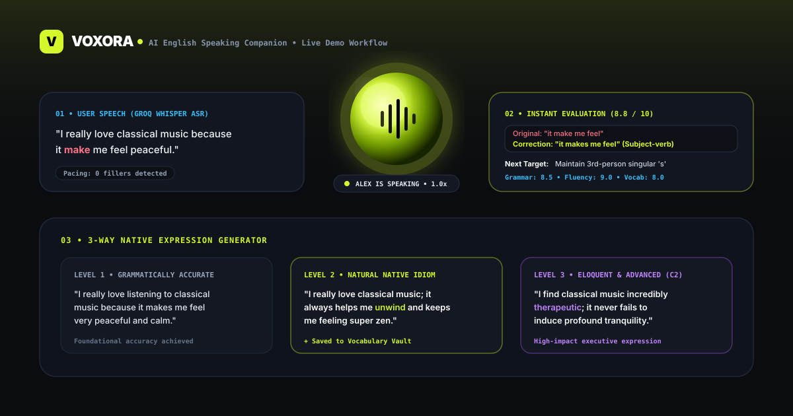
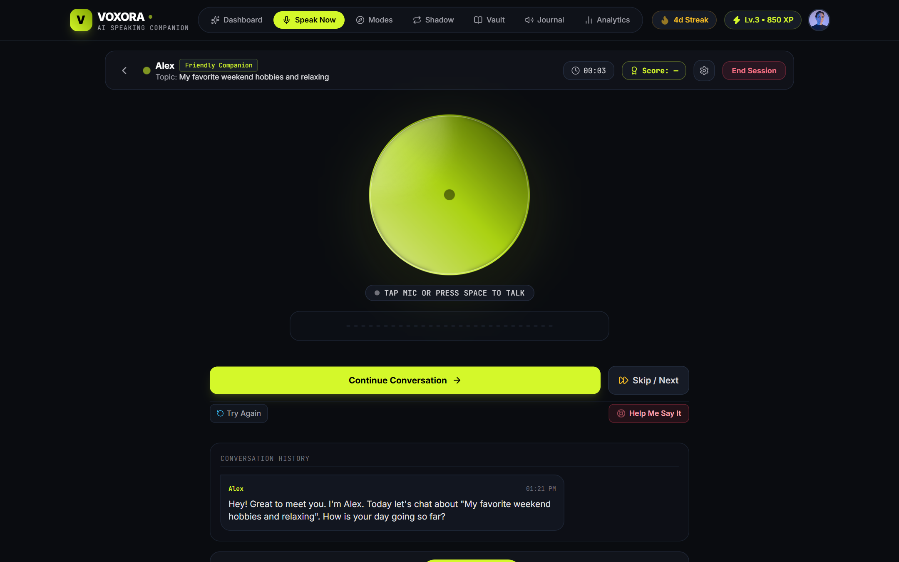
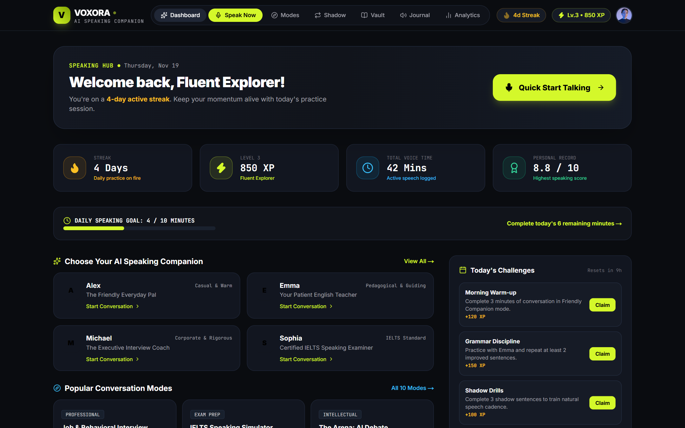
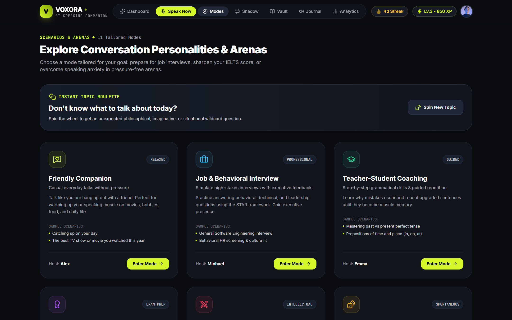
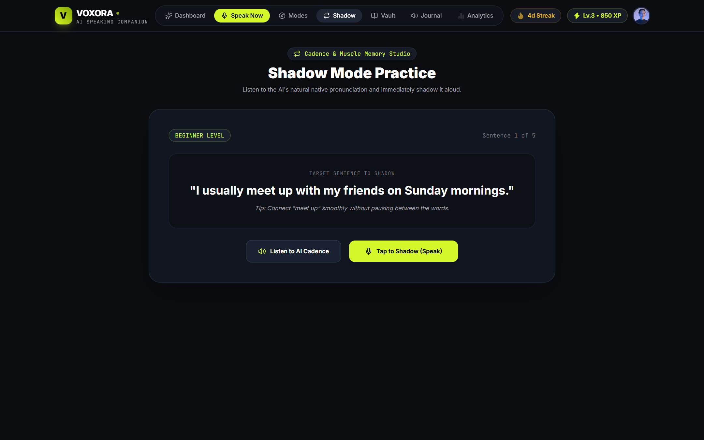
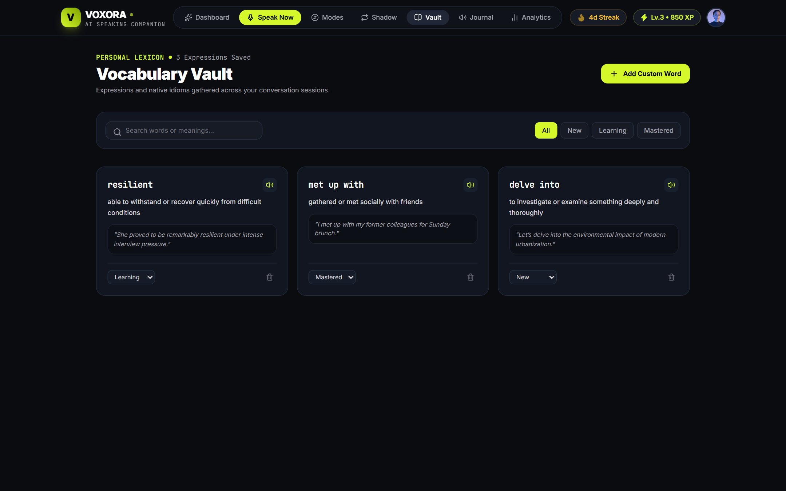
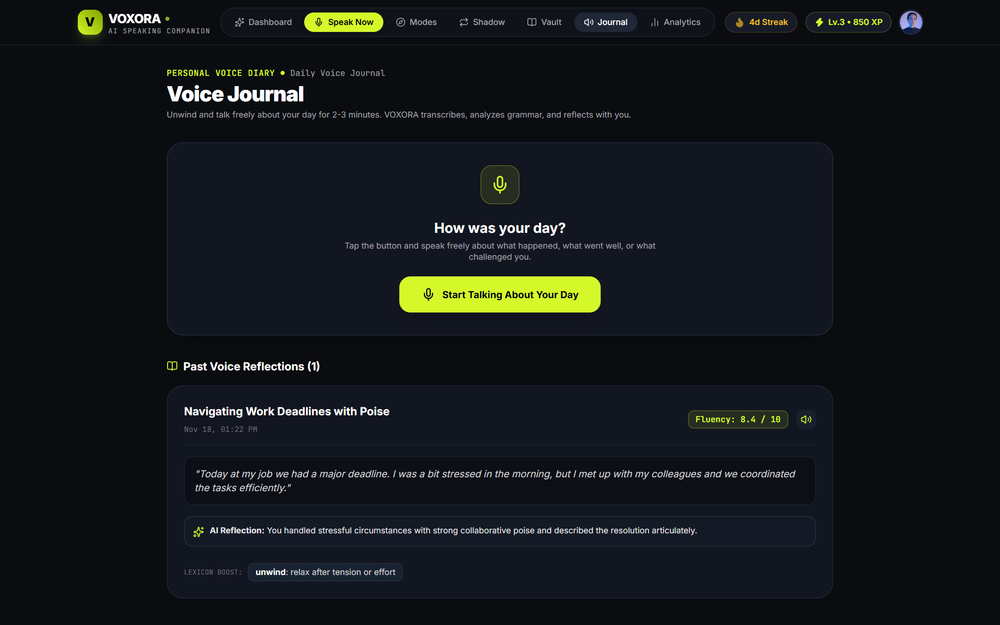
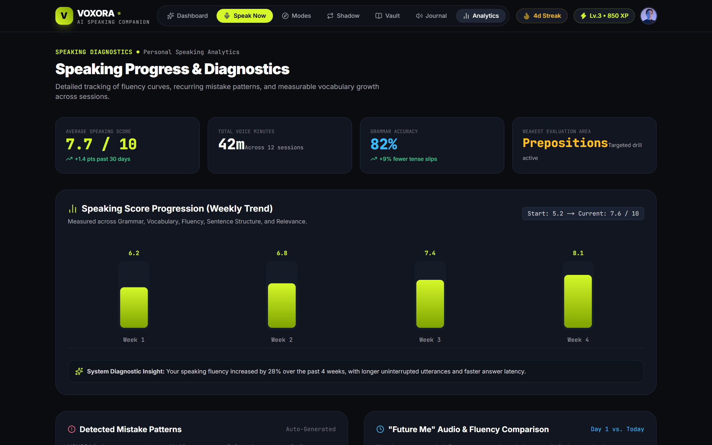
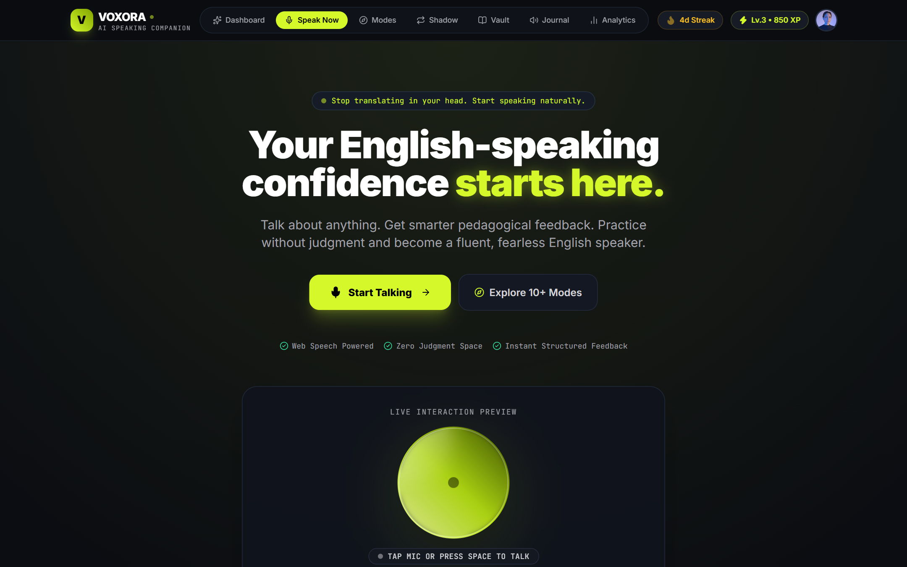

<div align="center">

# 🎙️ VOXORA — Your AI Speaking Companion

**Stop translating in your head. Start speaking naturally.**

An immersive, intelligent English-speaking companion platform combining the warmth of a friendly companion, the pedagogy of an English teacher, the rigor of an IELTS examiner, and the precision of an executive interview coach.

---

### 🌐 Live Production Deployment
### 👉 **[https://voxora-ruddy.vercel.app](https://voxora-ruddy.vercel.app)** 👈

---

<!-- Shields.io Badges -->
[](https://voxora-ruddy.vercel.app/)
[](https://voxora-ruddy.vercel.app/)
[](https://nextjs.org/)
[](https://www.typescriptlang.org/)
[](https://tailwindcss.com/)
[](https://ai.google.dev/)
[](https://groq.com/)
[](https://supabase.com/)
[](https://opensource.org/licenses/MIT)

</div>

---

## 🎬 Live Conversation & Pedagogical Loop

<div align="center">
  
</div>

---

## 📸 Visual Tour: Every Feature in Action

### 1. Live Voice Speaking Arena & 3D Audio Avatar
> Practice spontaneous English conversations. The 3D audio sphere transitions dynamically between **Idle** (breathing glow), **Listening** (cyan soundwave ripple), **Processing** (rotation shimmer), and **Speaking** (lime acoustic waveform).

<div align="center">
  
</div>

---

### 2. Multi-Tier Feedback & 3-Way Native Expression Generator
> Never get discouraged by red ink. Receive an honest breakdown across **Grammar (/10)**, **Vocabulary (/10)**, **Fluency (/10)**, **Sentence Structure (/10)**, **Relevance (/10)**, and **Filler Word Detection** without interrupting your flow.

```
• Level 1 (Grammatical):   "I really love listening to classical music because it makes me feel peaceful."
• Level 2 (Conversational): "I really love classical music; it always helps me unwind and keeps me feeling super zen."
• Level 3 (Eloquent C2):   "I find classical music incredibly therapeutic; it never fails to induce profound tranquility."
```

---

### 3. User Dashboard & Gamified Streak Hub
> Daily speaking minutes progress bar, XP levels (*Novice* to *Native Virtuoso*), active streak flame tracker, and one-click quick-start practice.

<div align="center">
  
</div>

---

### 4. 11 Specialized Conversation Scenarios & Instant Topic Roulette
> Tailor practice to your specific goals: Job Interviews (STAR method), IELTS Speaking Mock (Parts 1, 2, and 3 cue cards), Debate Arena, The Pressure Room (15-sec rapid fire), Collaborative Storytelling, Roleplay, and Speak Without Fear.

<div align="center">
  
</div>

---

### 5. Shadow Mode Studio (Speech Cadence & Pronunciation Match)
> Listen to native cadence, repeat the target sentence, and receive real-time word-by-word diff analysis with accuracy percentages to eliminate omitted prepositions and connectives.

<div align="center">
  
</div>

---

### 6. Personal Vocabulary Vault
> Save high-utility expressions, idioms, and collocations encountered during speaking sessions. Replay audio pronunciations, study example contexts, and mark expressions as *Mastered*.

<div align="center">
  
</div>

---

### 7. Voice Journal (Daily Spoken Reflection Diary)
> Unwind and speak freely for 2 minutes about your day. The AI extracts a clean transcript, upgrades your vocabulary, and provides a warm empathetic reflection.

<div align="center">
  
</div>

---

### 8. Speaking Diagnostics & "Future Me" Audio Analytics
> Track measurable speaking score gains over time, detect recurring grammatical habits (e.g. irregular past tense verbs), and compare your baseline Day 1 audio with Day 30+ progress.

<div align="center">
  
</div>

---

### 9. Editorial Landing Page
> Art-directed dark aesthetic built for serious English learners, featuring interactive voice previews and clear transparent guidance.

<div align="center">
  
</div>

---

## 🎭 7 Authentic AI Personalities

Each companion is engineered with distinct system prompts, speaking styles, correction styles, and voice profiles:

| Companion | Role | Personality & Style | Voice Calibration |
| :--- | :--- | :--- | :--- |
| **Alex** | Friendly Pal | Casual, funny, uses natural idioms, zero pressure | Pitch: 1.0 • Rate: 1.0x |
| **Emma** | English Teacher | Methodical, supportive, guides grammar repetition drills | Pitch: 1.1 • Rate: 0.92x |
| **Michael** | Executive Coach | Direct, corporate, behavioral STAR method feedback | Pitch: 0.95 • Rate: 1.02x |
| **Sophia** | IELTS Examiner | Formal, precise, IELTS band descriptors (Parts 1, 2, 3) | Pitch: 1.05 • Rate: 0.98x |
| **Ryan** | Debate Partner | Quick-witted, intellectual, challenges premises constructively | Pitch: 0.98 • Rate: 1.05x |
| **Mia** | Gentle Beginner | Patient, simplified vocabulary, eliminates speaking anxiety | Pitch: 1.08 • Rate: 0.88x |
| **Daniel** | Nuance Stylist | Advanced vocabulary, native collocations, literary cadence | Pitch: 1.0 • Rate: 1.0x |

---

## ⚡ Instant Action Controls & The Skip Feature

- **Continue Conversation**: Seamlessly begin your next speaking turn.
- **Skip / Next Question**: Jump topics immediately or draw an unexpected wildcard from the roulette pool.
- **Try Again**: Re-answer the same prompt with refined delivery.
- **Show Better Answer**: Modal displaying a native exemplar model with 1-click audio playback.
- **Practice My Mistake**: 10-second repetition drill reinforcing the correct grammatical pattern.
- **Explain My Mistake**: Jargon-free, simple grammatical breakdown.
- **Emergency Rescue ("Help Me Say It")**: Stuck mid-thought? Type or speak fragments to get instant Simple, Natural, and Advanced sentence formulations.

---

## 🧱 Production Architecture

```
VOXORA
├── Frontend (Next.js 14 App Router, TypeScript, Tailwind CSS, Framer Motion)
│   ├── Browser Web Speech API (Real-time SpeechRecognition & SpeechSynthesis)
│   ├── Audio Analyser (Waveform frequency & 3D breathing sphere states)
│   └── Offline-First Local Store (Graceful zero-crash guest mode)
│
├── AI Orchestration Layer (src/lib/ai/)
│   ├── Primary LLM: Google Gemini 3.5 Flash (fallback to 3.1 Flash-Lite & 2.5 Flash)
│   ├── High-Speed Secondary LLM: Groq (Qwen 3.8 27B / GPT-OSS 120B)
│   ├── High-Speed ASR: Groq Whisper Large v3 Turbo (sub-200ms audio transcription)
│   └── Pedagogical Engine (Single-call combined response & structured JSON evaluation)
│
└── Backend Database & Auth (Supabase PostgreSQL)
    ├── Tables: profiles, conversations, conversation_messages, speaking_evaluations,
    │           user_progress, vocabulary, user_achievements, learning_memory, daily_challenges
    ├── Security: Row Level Security (RLS) on all 9 tables
    └── Auth: Email/Password & Google OAuth
```

---

## 🚀 Local Development Setup

### 1. Clone & Install
```bash
git clone https://github.com/moazzem-hossain-majumder/VOXORA.git
cd VOXORA
npm install
```

### 2. Configure Environment (`.env.local`)
Create `.env.local` using the template below:
```env
# AI Providers
GROQ_API_KEY=your_groq_key_here
GEMINI_API_KEY=your_gemini_key_here
HF_TOKEN=your_huggingface_token_here

# Model Chains
LLM_CHAIN=gemini:gemini-3.5-flash,gemini:gemini-3.1-flash-lite,gemini:gemini-2.5-flash,groq:qwen/qwen3.8-27b
GEMINI_MODEL=gemini-3.5-flash
GROQ_MODEL=qwen/qwen3.8-27b
ASR_MODELS=whisper-large-v3-turbo,whisper-large-v3
AI_PROVIDER=gemini

# Supabase Database & Auth
NEXT_PUBLIC_SUPABASE_URL=https://your-project.supabase.co
NEXT_PUBLIC_SUPABASE_PUBLISHABLE_KEY=your_publishable_key_here
NEXT_PUBLIC_SUPABASE_ANON_KEY=your_publishable_key_here

NEXT_PUBLIC_APP_URL=http://localhost:3000
```

### 3. Run Development Server
```bash
npm run dev
```
Open **[http://localhost:3000](http://localhost:3000)** in Chrome or Edge for full Web Speech API microphone support.

---

## 🗄️ Database Setup (Supabase)

All 9 tables, indexes, and Row-Level Security policies are packaged in [`src/lib/supabase/schema.sql`](src/lib/supabase/schema.sql).

1. Open your Supabase project dashboard.
2. Navigate to **SQL Editor** &rarr; **New Query**.
3. Copy the contents of [`schema.sql`](src/lib/supabase/schema.sql) and click **Run**.
4. The schema is 100% idempotent and safe to run at any time.

---

## 🚢 Vercel Deployment

1. Fork or import **`moazzem-hossain-majumder/VOXORA`** on [Vercel](https://vercel.com/new).
2. Paste the environment variables from `.env.local`.
3. Click **Deploy** — automatic CI/CD is active on every `git push origin main`.

---

## 🛡️ Security & Privacy
- Zero client-side API key leakage (`GROQ_API_KEY`, `GEMINI_API_KEY`, and `HF_TOKEN` are strictly server-side).
- Row-Level Security (RLS) ensures users can only access their own speaking sessions and scores.
- Clear acoustic disclaimers: transcript-based syntax evaluation is never falsely presented as phoneme-level acoustic audio analysis.

---

## 📄 License
Released under the [MIT License](LICENSE). Built with dedication for English learners worldwide.
